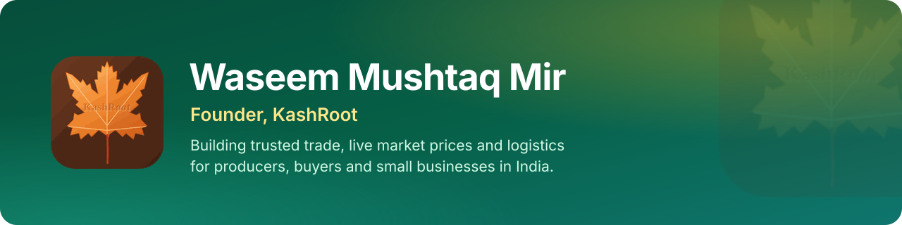
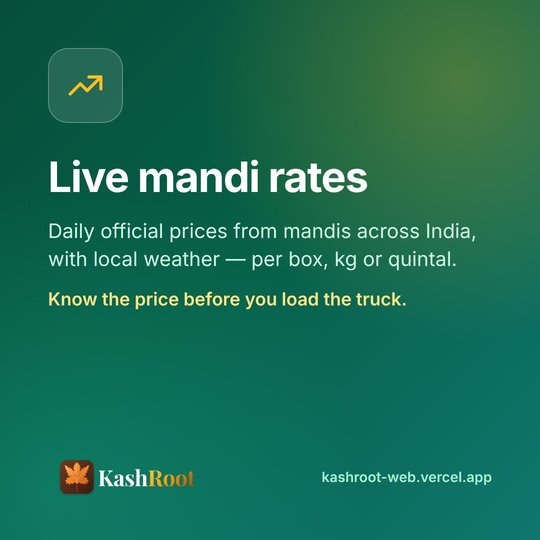
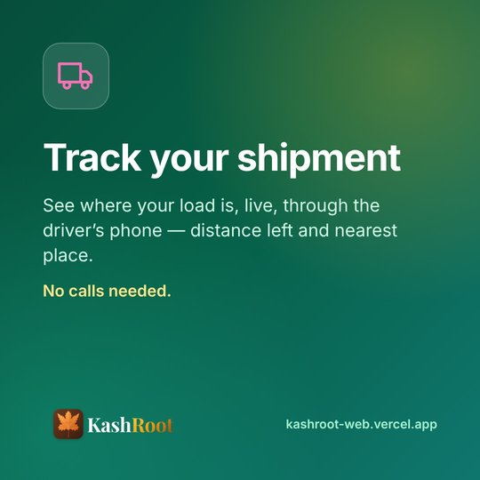
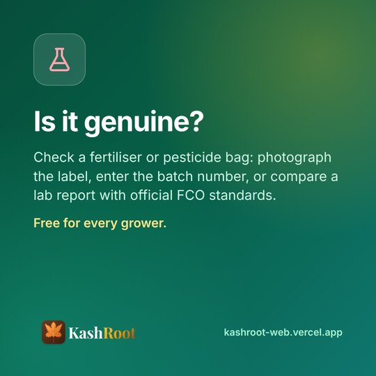

  

  
  
  

  <b>Founder · Product builder · Full-stack developer</b> 
  Bengaluru · Rooted in Shopian, Kashmir

---

## 👋 About me

I'm the founder of **KashRoot**, a digital trade and services platform that helps producers, buyers and small businesses trade with more trust and less guesswork.

I come from Shopian, Kashmir, where orchards and mandis are part of everyday life. Growers often sell without knowing the day's real price, pay in advance for inputs they cannot verify, and lose track of their goods once the truck leaves. I build practical software for those everyday problems — simple enough for a first-time smartphone user, solid enough to handle real money and real deliveries.

I lead KashRoot end to end: the product, the user experience, the web platform, the database and its security.

## 🍁 KashRoot

<table>
  <tr>
    <td width="62%" valign="top">
      <b>Trusted trade, live market prices and logistics for producers, buyers and small businesses.</b>
        
      KashRoot started with horticulture in Jammu &amp; Kashmir — apple, walnut, saffron — and is built for any trade where fair prices and reliable delivery matter. It is live in early access.
        
      
      
    </td>
    <td width="38%" valign="top">
      <b>At a glance</b>
       🧭 10 portals, each with its own sign-in
       🗣️ 4 languages — Kashmiri, Urdu, Hindi, English
       💸 Pay after delivery, direct UPI
       📊 Official daily mandi prices
       🔒 Row-level security on every table
       🚀 Live in early access
    </td>
  </tr>
</table>

  
  
  

  
  
  

<b>Everything KashRoot does</b>

 

| | |
|---|---|
| 🛡️ **Pay after delivery** | Buyers pay the seller directly by UPI only after the goods arrive and have been checked. The platform never holds anyone's money. |
| 📈 **Live mandi rates** | Daily official prices (Agmarknet via data.gov.in) with outlier checks, per box, kg or quintal — plus rates posted and cross-checked by local Mandi Helpers. |
| ⚖️ **Price comparison** | Growers, traders and dealers list products; buyers compare offers side by side. |
| 🚚 **Shipment tracking** | Live location from the driver's phone, distance left and nearest place, shared with a simple link. |
| ❄️ **Cold storage & machinery** | Find and book storage space and equipment, paying the owner directly. |
| 🧪 **Input checks** | Verify fertiliser and pesticide batches from a label photo, a batch number, or a lab report against official FCO standards. |
| 🌦️ **Weather & orchard health** | Village-level forecasts with farm tips, scab-risk alerts, photo checks and a spray diary. |
| 👩‍🌾 **Expert advice** | Questions with crop photos to agronomists, written answers or a video call. |
| 🗣️ **Voice assistant** | Answers in Kashmiri, Urdu, Hindi and English. |

## 🛠️ How I build

- **Product first.** Every screen is designed for a first-time smartphone user — large tap targets, plain language, voice where typing is hard.
- **Trust by design.** Money never passes through the platform; sellers are identity-checked; every rate shows who posted it and whether it was confirmed.
- **Secure by default.** Row-level security on every table, audited `SECURITY DEFINER` functions for privileged actions, strict Content-Security-Policy, rate-limited sign-in and a private admin console with its own code.
- **Privacy.** Identity checks keep only what is needed — never a full Aadhaar number.
- **Real data only.** Agmarknet, Open-Meteo and OpenStreetMap — and an honest message when a source is down, never invented numbers.
- **Tested.** End-to-end browser tests for every portal and database tests for every access rule.

## 🧰 Tech stack

  
  
  
  
  
  
  
  
  
  
  

## 🤝 Let's work together

I'm glad to talk with **farmers and traders, cooperatives and FPOs, logistics and cold-storage partners, agri-experts, investors and builders** working on fair, transparent trade in India.

The best way to reach me is a message on **[LinkedIn](https://www.linkedin.com/in/waseem-mushtaq-mir-b615372aa/)**.
